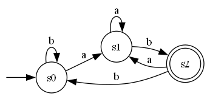
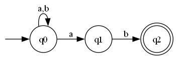
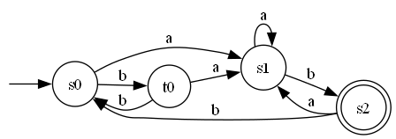
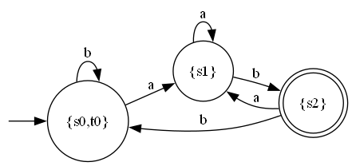
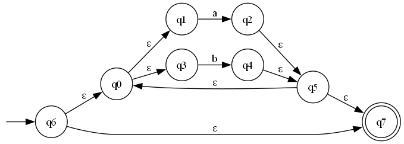
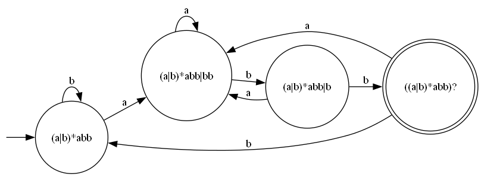
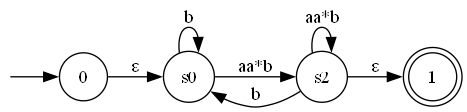
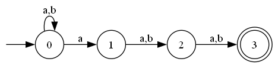
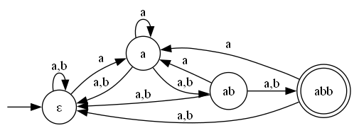
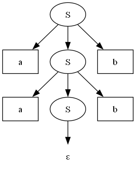

# automata-extensions

Extension pédagogique de la bibliothèque
[automata-lib](https://pypi.org/project/automata-lib/) (version 9.2.0), pour un
cours de théorie des langages (L2 Informatique).

Elle ajoute à `DFA` et `NFA` les algorithmes classiques qui manquent (états
utiles, minimisation, produit, quotients, miroir, déterminisation...), un module
d'**expressions régulières** (dérivées de Brzozowski, Thompson, conversions dans
les deux sens), un volet **grammaires** (grammaires régulières et algébriques,
arbres de dérivation) et quelques **objets algébriques** (automate résiduel,
morphismes, monoïde syntaxique). **Aucun fichier d'automata-lib n'est modifié** :
tout est ajouté par héritage et mixins.

## Sommaire

1. [Installation](#installation)
2. [Démarrage rapide](#démarrage-rapide)
3. [Schémas](#schémas)
4. [Ce qui est fourni](#ce-qui-est-fourni)
5. [Conception](#conception)
6. [Organisation du code](#organisation-du-code)
7. [Tests](#tests)
8. [Limites connues](#limites-connues)
9. [Méthode de travail](#méthode-de-travail)
10. [Références](#références)

## Installation

Prérequis : Python 3.10 ou plus, et [Graphviz](https://graphviz.org/) pour dessiner
les automates (la description DOT est produite sans Graphviz, mais pas les images).

**Graphviz sous Windows** (PowerShell) :

```powershell
winget install Graphviz.Graphviz
setx PATH "%PATH%;C:\Program Files\Graphviz\bin"
```

Redémarre ensuite le terminal (ou PyCharm). Sous macOS : `brew install graphviz` ;
sous Linux : `sudo apt install graphviz`.

**Le projet**, à la racine du dépôt, dans un environnement virtuel :

```powershell
pip install -e ".[dev]"
```

Cela installe `automata-lib` 9.2.0, `pytest`, et le paquet en mode éditable
(les modifications du code sont prises en compte sans réinstaller).

```python
from automata_extensions.fa import ExtendedDFA, ExtendedNFA   # automates
from automata_extensions.regex import parse_regex             # expressions régulières
from automata_extensions.grammar import ContextFreeGrammar    # grammaires
```

## Démarrage rapide

```python
from automata_extensions.fa import ExtendedDFA

# Les mots qui ont un nombre pair de 'a'
pair = ExtendedDFA(
    states={'pair', 'impair'},
    input_symbols={'a', 'b'},
    transitions={
        'pair': {'a': 'impair', 'b': 'pair'},
        'impair': {'a': 'pair', 'b': 'impair'},
    },
    initial_state='pair',
    final_states={'pair'},
)

pair.accepts("aab")                  # True
pair.complement().accepts("aab")     # False
pair.to_regex()                      # une expression régulière équivalente
pair.to_grammar()                    # une grammaire régulière équivalente
pair.syntactic_monoid().elements()   # ['', 'a'] : le groupe Z/2
pair.save("automate.png")            # dessin (Graphviz requis)
```

Toutes les méthodes **renvoient un nouvel automate** sans modifier l'ancien, donc
elles se composent comme des transformations mathématiques :

```python
dfa.trim().minimize().to_regex()
nfa.reverse().determinize().minimize()
```

Le script [`exemples/demo.py`](exemples/demo.py) montre une douzaine d'exemples
complets (minimisation, opérations, NFA, expressions régulières, grammaires,
quotients, automate résiduel, monoïde, morphismes). Chaque exemple vérifie son
résultat par un `assert` :

```powershell
python exemples/demo.py
```

## Schémas

Les images ci-dessous sont produites par la méthode `save()` des objets
eux-mêmes. Pour les régénérer : `python docs/generer_schemas.py`.

**Mots finissant par `ab` : un DFA et un NFA**




**Minimisation** : les états `s0` et `t0` sont équivalents et sont fusionnés.




**Expressions régulières** : automate de Thompson de `(a|b)*`, et automate des
dérivées de `(a|b)*abb` (chaque état est une expression).




**Élimination d'états** : le GNFA du DFA « finit par ab » après suppression de `s1`
(les transitions portent des expressions régulières).



**Automate résiduel** : pour « la 3ᵉ lettre avant la fin est un `a` », le DFA minimal
a 8 états, mais l'automate résiduel n'en a que 4.




**Arbre de dérivation** de `aabb` pour la grammaire `S -> a S b | ε`.



## Ce qui est fourni

Les 62 points du cahier des charges sont réalisés. La table complète, avec la
méthode et le fichier de chaque point, est dans
[`docs/CORRESPONDANCE.md`](docs/CORRESPONDANCE.md). En résumé :

| Niveau | Points | Contenu |
|---|---|---|
| 1 | 1 à 41 | parcours, états utiles, cycles, simulation, complétion, complément, produit, inclusion, isomorphisme, minimisation, déterminisation, miroir, ε-transitions, export DOT, SVG, PDF, TikZ |
| 2 | 42 à 54 | union, intersection, différence, concaténation, étoile, quotients, dérivées de Brzozowski, Thompson, automate vers expression régulière (élimination d'états et lemme d'Arden) |
| 3 | 55 à 62 | grammaires régulières, arbres de dérivation, systèmes d'équations, classes de Myhill-Nerode, automate résiduel, morphismes, monoïde syntaxique |

Chaque méthode a une docstring qui indique ses paramètres, son résultat, sa
**complexité** et sa référence. Les algorithmes sont expliqués, avec leur
complexité, dans [`docs/ALGORITHMES.md`](docs/ALGORITHMES.md).

## Conception

- **Héritage et mixins.** `ExtendedDFA` et `ExtendedNFA` héritent de `DFA`/`NFA` et
  d'une base commune `ExtendedFA`, qui assemble les mixins (un par famille
  d'algorithmes : `analyse`, `cycles`, `minimisation`, `export`...). Un algorithme
  qui ne dépend que des états et des transitions est écrit **une seule fois** et
  marche pour les deux classes.
- **Immuabilité.** Comme dans automata-lib, un automate ne change jamais.
- **DFA ou NFA : on regarde la classe, pas la forme des données.** Les états peuvent
  être n'importe quel objet hachable : ensembles (`frozenset`) après une
  déterminisation ou une minimisation, couples après un produit, expressions
  régulières dans l'automate des dérivées.
- **`ExtendedGNFA` est à part.** Ses transitions portent des expressions régulières
  entre états (et non des symboles), les algorithmes des autres automates ne s'y
  appliquent pas.
- **Nommage.** Calculs : `accessible_states()`, `trim()`, `reverse()`. Prédicats :
  `is_complete()`, `is_empty()`. Conversions : `to_regex()`, `to_grammar()`,
  `to_dfa()`.
- **Algorithmes pédagogiques.** Lisibles et proches des démonstrations du cours, sans
  optimisation prématurée.
- **Un mot est une chaîne de caractères**, chaque caractère étant un symbole ; le mot
  vide est `''` et l'ε-transition est la clé `''`.

## Organisation du code

```
automata_extensions/
  fa/                      automates finis
    base.py                ExtendedFA : assemble tous les mixins
    dfa.py  nfa.py  gnfa.py
    mixins/                un fichier par famille d'algorithmes
    morphisms.py  monoid.py  graphviz_tools.py
  regex/                   expressions régulières (arbre, lecteur, dérivées, Thompson, Arden)
  grammar/                 grammaires, analyse, arbres de dérivation
  pda/  tm/                dossiers réservés, vides
tests/                     tests pytest (un fichier par famille)
docs/                      correspondance avec le sujet, algorithmes, schémas
exemples/demo.py           exemples exécutables
```

## Tests

```powershell
python -m pytest
```

On attend **324 tests réussis et 1 ignoré**. Le test ignoré compile le LaTeX produit par
`latex()` : il est facultatif et ne tourne que si `pdflatex` est installé et si la variable
`RUN_LATEX_TESTS` vaut 1 (`$env:RUN_LATEX_TESTS=1` sous PowerShell).

Les résultats sont comparés à des **références indépendantes** de ce qui est testé :
formules (par exemple a^n b^n), force brute sur tous les mots courts, définition du
monoïde syntaxique par les contextes, moteur d'expressions d'automata-lib. Les tests
vérifient aussi que les automates passés en argument ne sont pas modifiés.

## Limites connues

- `minimize()`, `is_minimal()`, `equivalence_classes()`, `distinguishable_pairs()`,
  `is_isomorphic()` et les morphismes exigent un automate **déterministe** : pour un NFA,
  écrire `nfa.determinize().minimize()`. Le complément, le produit, l'inclusion,
  l'égalité de langages, les quotients, l'automate résiduel et le monoïde syntaxique
  acceptent un NFA (ils le déterminisent eux-mêmes).
- Un mot est une chaîne lue caractère par caractère : les symboles des automates sont donc
  des caractères uniques. Dans les expressions régulières, `| * + ? ( ) ε ∅` ne peuvent pas
  servir de symboles. Les grammaires acceptent des symboles de plusieurs caractères (séparés
  par des espaces), mais `parse` reçoit alors une liste de symboles.
- `RegularGrammar` ne traite que les grammaires linéaires **à droite**.
- L'analyse d'une grammaire algébrique (`parse`) est polynomiale mais volontairement
  simple : prévue pour des mots courts, pas pour de gros textes.
- La minimisation est celle du remplissage de table (O(|Q|³·|Σ|)), pas celle de Hopcroft.
- Les paquets `pda` et `tm` du plan initial sont vides : le sujet n'en demande pas
  d'algorithme.

## Méthode de travail

Comme le suggère le sujet :
cahier des charges discuté d'abord, puis un algorithme à la fois, chacun accompagné de
ses tests, exécutés en local avant de continuer. Les bugs trouvés en route (par exemple
l'état initial artificiel de `reverse()` qui empêchait la minimalité de l'algorithme de
Brzozowski) ont été corrigés et gardés sous forme de tests.

## Références

- Hopcroft, Motwani, Ullman, *Introduction to Automata Theory, Languages, and Computation*.
- Brzozowski (1962), minimisation par double renversement ; Brzozowski (1964), dérivées.
- Thompson (1968), construction des automates d'expressions régulières.
- Arden (1961), lemme d'Arden ; Tarjan (1972), composantes fortement connexes.
- Denis, Lemay, Terlutte (2002), automates résiduels (RFSA).
- Pin, *Mathematical foundations of automata theory*, monoïde syntaxique.
- Cormen, Leiserson, Rivest, Stein, *Introduction to Algorithms*, parcours de graphes.
